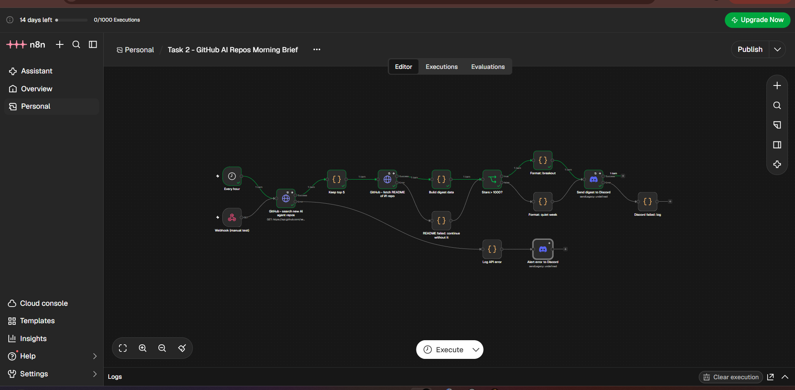
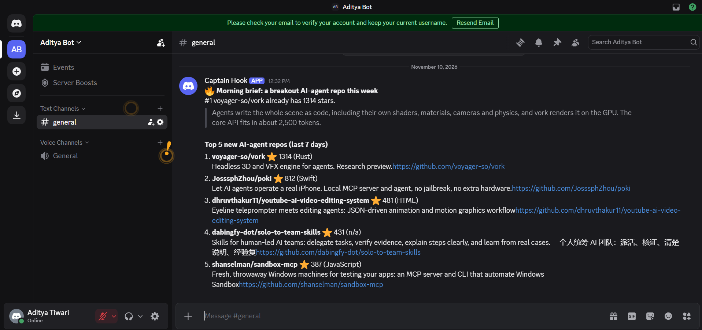

# Oytra – Automation & QA Developer Assessment · Aditya Tiwari

| File | What it is |
|---|---|
| `Task1_QA_Report_AdityaTiwari.pdf` | Task 1 – 11 bugs in the RealWorld (Conduit) app + root-cause analysis |
| `01_…07_*.png` | Evidence screenshots for the Task 1 report |
| `Task2_Workflow_AdityaTiwari.json` | Task 2 – n8n workflow: hourly "AI-agent repos" brief to Discord |
| `Bonus_UptimeMonitor_AdityaTiwari.json` | Bonus – uptime monitor with alerts + daily summary |
| `Documentation_AdityaTiwari.md` | One-page summary of the work |

## Task 2 – GitHub AI-Repos Morning Brief

**APIs used and why**
- **GitHub REST API** – `search/repositories` (`topic:ai-agents created:>{7 days ago}`, sorted by stars) and `repos/{owner}/{repo}/readme`. Free, no key needed, real-time data, and two dependent calls (the second uses the first one's result).
- **Discord Webhook** – the output channel. One URL, no bot setup, supports markdown.

**Flow**
`Schedule (hourly) / Webhook (manual test)` → **GitHub search** → **Keep top 5** (Code: drop forks + archived, sort by stars, keep 5) → **Fetch README of #1** → **Build digest data** (Code: strip markdown/HTML/badges, 280-char summary) → **IF stars > 1000** → *breakout* or *quiet week* message → **Discord**.

**Transformation**
The raw search JSON (≈20 repos × 80 fields) is reduced to 5 objects `{name, stars, language, description, url}`. The README goes from raw markdown to a cleaned plain-text summary. The final message is trimmed to Discord's 2,000-character limit.

**Error handling**
- GitHub search: 3 retries (5 s apart). If it still fails, the error output → `Log API error` (console + structured message) → error alert to Discord.
- README fetch fails (404 / rate limit): continue without it via `README failed: continue without it` – the digest still goes out.
- No new repos: an empty result is handled, so the "quiet week" message is sent instead of crashing.
- Discord send fails: retried, then logged on the error output.
- Every execution is saved, so failures show up in the Executions tab.

## Setup
1. Run n8n: `docker run -it --rm -p 5678:5678 -v n8n_data:/home/node/.n8n docker.n8n.io/n8nio/n8n` → open http://localhost:5678 (or use an n8n Cloud trial).
2. Discord: Channel settings → Integrations → Webhooks → New webhook → copy the URL.
3. In n8n: **Credentials → New → Discord Webhook** → paste the URL → name it `Discord Webhook account`.
4. Import each JSON (⋯ → Import → From File / From URL) → open each Discord node and select the credential → Save.
5. Test: click **Execute** and pick the "Every hour" trigger, or call `GET <your-n8n>/webhook-test/morning-brief`. Then **Publish**.
6. Optional: add a GitHub token as header `Authorization: Bearer <token>` on both GitHub nodes to raise the rate limit from 60 to 5,000 requests/hour.

**Bonus:** change `target` in *Set target + start timer* to the URL you want to monitor (the default is `https://demo.realworld.io`, which is currently down, so you can see an alert straight away).

## Running the Task 1 app locally
Backend: `nsidnev/fastapi-realworld-example-app` (PostgreSQL, `.env` with `DATABASE_URL`, `alembic upgrade head`, `uvicorn app.main:app --port 8000`).
Frontend: `gothinkster/react-redux-realworld-example-app` with `API_ROOT` in `src/agent.js` set to `http://localhost:8000/api`, served on :4100.

## Proof it runs
Task 2 run on n8n Cloud (10 Nov 2026): green path end to end, and the digest delivered to Discord.

